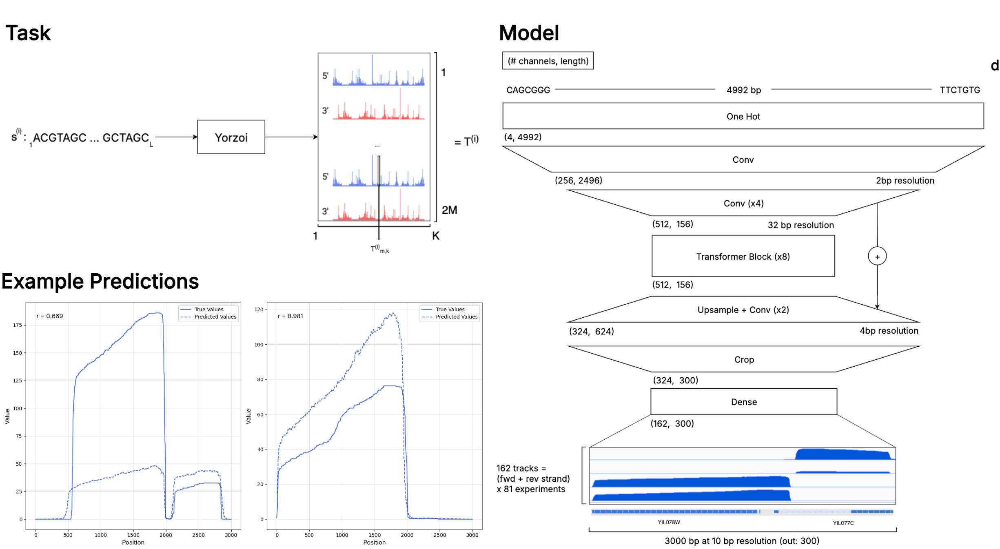

# Yorzoi: RNA-seq coverage prediction from DNA sequence
> [!NOTE]  
> In case of any questions, reach out to mail@timonschneider.de - always happy to help!

yorzoi is a deep neural network that predicts RNA-seq coverage from DNA sequence in Yeast (S. Cerevisiae). It is available via PyPI and Huggingface (see installation).


## No-Code Usage (no coding or installation required)
Yorzoi is available at [yorzoi.eu](https://www.yorzoi.eu). If you want more control over the model you need to install it as a PyPI package (see [Installation](#installation)).

## HTTP API (no installation or GPU required)
If you just want to get model predictions programmatically but don't need direct model access, you can use our API ([open-source implementation](https://github.com/tdsone/yorzoi-app)). (Cold start) Requests might take up to 10s. Here is an example request: 
```bash
curl --request POST \
  --url https://tom-ellis-lab--yorzoi-app-fastapi-app.modal.run/generate \
  --header 'Content-Type: application/json' \
  --data '{
  "sequences": ["ACGTGT"]
}'
```
or the same in Python: 
```bash
uv add requests numpy matplotlib
```
```python
import requests
import numpy as np
import matplotlib.pyplot as plt

url = (
    "https://tom-ellis-lab--yorzoi-api-yorzoiservice-web.modal.run"
    "/v1/models/yorzoi/predict"
)

sequence = "ACGT" * 1248  # Example only; REPLACE with your DNA sequence.

FWD_TRACK_IDX = 17 # REPLACE with the track you want
REV_TRACK_IDX = FWD_TRACK_IDX + 81 # offset by 81 finds you the matching reverse track

response = requests.post(
    url,
    json={
        "sequences": [{"id": "example", "seq": sequence}],
        "tracks": [FWD_TRACK_IDX, REV_TRACK_IDX],  # First dataset: forward (+) and reverse (-). You can request 1 to 162 of the total available tracks.
        "window": "auto",
    },
    timeout=180,
)
print("Status code:", response.status_code)
response.raise_for_status()

result = response.json()
prediction = result["predictions"][0]
values = np.asarray(prediction["values"], dtype=np.float32)

# Coordinates are relative to the submitted sequence.
edges = (
    prediction["bin_start_bp"]
    + np.arange(values.shape[1] + 1) * prediction["bin_size_bp"]
)
# A full-window result can end with a partial bin.
edges[-1] = min(edges[-1], prediction["length"])

print("Shape:", values.shape)
print("Warnings:", prediction["warnings"])

plt.figure(figsize=(10, 4))
for row, track in zip(values, result["tracks"]):
    plt.stairs(row, edges, label=track["id"])

plt.xlabel("Position in input sequence [bp]")
plt.ylabel("Predicted coverage")
plt.legend()
plt.tight_layout()
plt.show()
```

## Installation

1. An NVIDIA GPU is recommended for fast inference. CPU works but is much slower.
2. _Yorzoi_ requires Python 3.12+ and PyTorch 2.5+ (for grouped-query attention support in `scaled_dot_product_attention`).
3. To work with a local checkout of this repository, run:
```bash
uv python install 3.12
uv sync
source .venv/bin/activate
```
4. To install the published package from PyPI instead, run:
```bash
uv venv --python 3.12
source .venv/bin/activate
uv pip install yorzoi
```

Yorzoi uses PyTorch's built-in flash-attention (via `scaled_dot_product_attention`), so no separate `flash-attn` install is needed.

In case you struggle with the installation - let me know (email below).

## Quick Start: Make a prediction

Find a more extensive demo in [demo.ipynb](demo.ipynb)

```python
import random
import torch
from yorzoi.dataset import GenomicDataset
from yorzoi.model.borzoi import Borzoi

model = Borzoi.from_pretrained("tom-ellis-lab/yorzoi")
model.to("cuda:0")
model.eval()

def random_dna_sequence(length):
    return ''.join(random.choices('ACGT', k=length))

sequences = torch.stack([torch.tensor(GenomicDataset.one_hot_encode((random_dna_sequence(4992))), dtype=torch.float32) for _ in range(5)])

print(f"\nPredicting RNA-seq coverage for {sequences.shape[0]} sequences\n")

sequences = sequences.to("cuda:0")

with torch.autocast(device_type="cuda"):
    predictions = model(sequences)
```

# Dataset

Preprocessed training data is available on [Hugging Face](https://huggingface.co/datasets/tom-ellis-lab/yeast-RNA-seq).

## Brooks nanopore data

The Brooks source data is available in the Google Cloud Storage bucket [brooks-nanopore](https://console.cloud.google.com/storage/browser/brooks-nanopore?project=clex-415415):

- `alignment/`: BED alignment files.
- `annotations/`: GFF annotations.
- `genomes/`: reference genomes and associated index and chromosome-size files.

The individual bigWig coverage tracks used for training are not yet included in this bucket. Model output track names and ordering are provided in [track_annotation.json](track_annotation.json).

Access requires Google authentication; anonymous access is unavailable. Authenticated users can list and download files. This bucket uses **Requester Pays**: you must supply your own Google Cloud project with billing enabled to cover access and download costs.

## Human YAC RNA-seq data

The human YAC RNA-seq data is available in the [human_YAC_RNAseq folder of the yorzoi Google Cloud Storage bucket](https://console.cloud.google.com/storage/browser/yorzoi/human_YAC_RNAseq):

- `Alignments/`: BAM alignments, indexes, and strand-specific bigWig coverage tracks.
- `genome/`: human, yeast, and concatenated reference genomes, with indexes and annotations.
- `Fastqc/`: quality-control reports before and after trimming.

Dataset summaries and a file manifest are also included. Raw Illumina reads are not yet included in this bucket.

Access requires Google authentication; anonymous access is unavailable. Authenticated users can list and download files. This bucket uses **Requester Pays**: you must supply your own Google Cloud project with billing enabled to cover access and download costs.

# Roadmap

- [ ] Publish evaluation code and data
- [ ] Publish data processing tools and raw data

# Contact

In case of any issues, feedback or thoughts, here is my email: mail@timonschneider.de
